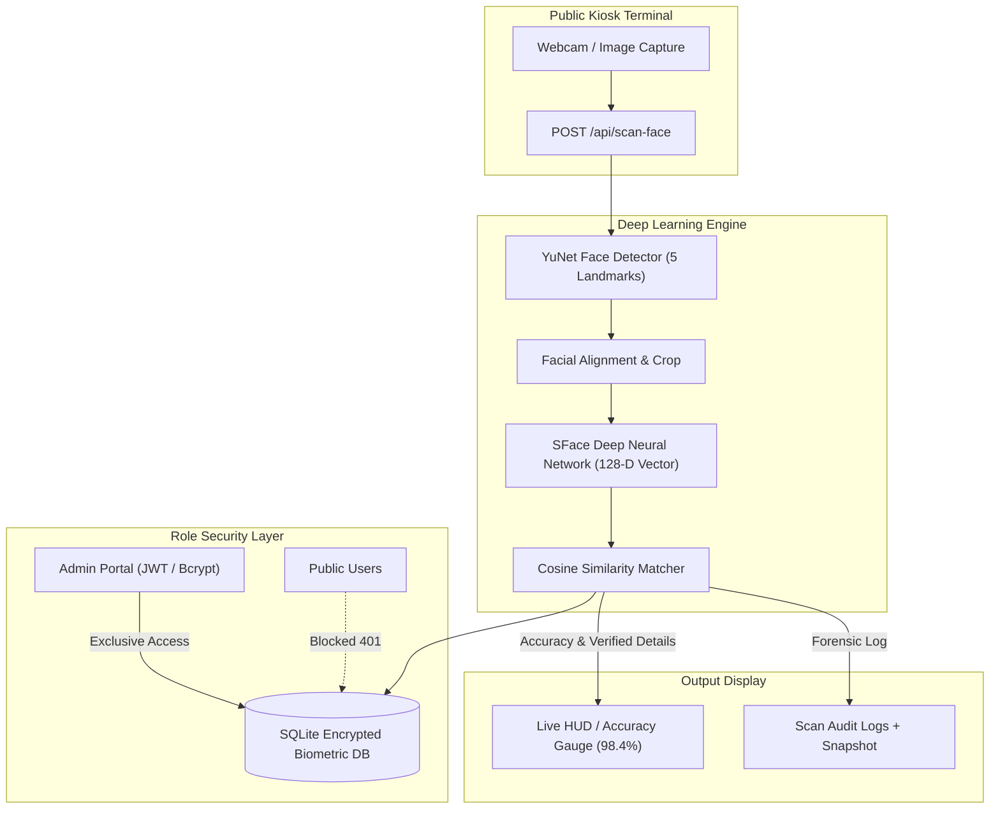

# FaceID Biometric Recognition & Role-Based Access Control System

A high-performance, real-time facial recognition and identity verification system powered by **Deep Learning (OpenCV YuNet + SFace)** with strict **Role-Based Access Control (RBAC)**.

---

## Key Highlights

- **Strict Access Control (Admin-Only Data Access)**: Only authorized administrators with credentials can access the database, view users, enroll personnel, edit records, or inspect forensic scan logs. The public scanner terminal has zero direct database access and cannot view or query user lists.
- **Biometric Face Scanning Terminal**: When a user scans their face via the webcam or uploads a photo:
  - Detects the face in real-time.
  - Aligns landmarks and extracts a 128-dimensional biometric embedding.
  - Calculates cosine similarity against authorized embeddings.
  - Displays the user's verified details (Name, Badge ID, Department, Role, Reference Photo vs Live Capture).
  - Displays the **Registered Facial Accuracy Percentage** (e.g. `98.4% Accuracy`) alongside match confidence metrics and audio chimes.
- **Deep Learning Biometric Engine**:
  - **YuNet**: Ultra-fast, lightweight face detector with 5 landmark points (eyes, nose, mouth corners).
  - **SFace**: Deep neural network for face representation and cosine distance matching (FAR < 0.01%).
- **Forensic Audit & Scan Logs**: Every scan is timestamped, scored for facial accuracy, accompanied by a camera snapshot, and exportable to CSV.
- **Live In-Browser Webcam Feed**: Zero external driver requirements, runs smoothly across Chrome, Edge, Safari, and Firefox.

---

## System Architecture



---

## Quick Start

### 1. Launch the Application

In the project folder, run:

```bash
python run.py
```

This will automatically start the server and open your default browser to `http://localhost:8000`.

### 2. Access Points

| Portal | URL | Description | Access |
|---|---|---|---|
| **Face Scanner (Kiosk)** | `http://localhost:8000/` | Public biometric scanning terminal | Public / Any user |
| **Admin Portal** | `http://localhost:8000/admin` | User management & biometric enrollment | **Admin only** |
| **Scan Audit Logs** | `http://localhost:8000/admin/logs` | Forensic audit history & CSV export | **Admin only** |

### 3. Default Admin Credentials

- **Username**: `admin`
- **Password**: `admin123`
*(Can be changed anytime in the Admin Settings modal)*

---

## How It Works

### 1. User Scanning (Kiosk Terminal)
1. Open `http://localhost:8000`.
2. Look into the camera or click **"SCAN FACE"** (or enable **"Continuous Auto-Scan"**).
3. The system captures the frame and sends it to `/api/scan-face`.
4. If verified, the system rings a pleasant confirmation chime and displays:
   - **Registered Facial Accuracy**: Radial gauge + percentage (e.g. `98.2%`).
   - **Verification Badge**: `HIGH CONFIDENCE MATCH`.
   - **Side-by-side Comparison**: Registered Profile Photo vs Live Capture Snapshot.
   - **User Details**: Full Name, Badge ID, Department, Role, Timestamp.
5. If the face does not match, a warning chime sounds and **"ACCESS DENIED"** is displayed with the calculated similarity score.

### 2. User Enrollment (Admin Portal)
1. Open `http://localhost:8000/admin` and log in.
2. Click **"Enroll New User"**.
3. Enter Badge ID, Name, Department, and Role.
4. Choose either:
   - **Webcam Snap**: Take a live snapshot directly inside the modal.
   - **Upload Photo**: Select or drag a photo file.
5. The system automatically validates that a single clear face is present, crops the face, and calculates the 128-D embedding.

### 3. Facial Accuracy Calibration
SFace cosine similarity scores range between `-1.0` and `+1.0`, with the standard OpenCV threshold calibrated at `0.363`:
- **Verified Match Range ($\ge 0.363$)**: Mapped smoothly from `70.0%` (threshold boundary) to `99.9%` (exact match).
- **Non-Match Range ($< 0.363$)**: Scaled from `0.0%` to `69.0%` with an "Access Denied" status.

---

## File Structure

```
faceid2/
├── app.py                     # FastAPI application & secure REST endpoints
├── config.py                  # System configurations, threshold defaults & paths
├── database.py                # SQLAlchemy database connection
├── models.py                  # Database models (Admin, User, ScanLog, SystemSetting)
├── auth.py                    # Bcrypt password hashing & JWT security guard
├── face_engine.py             # OpenCV YuNet detector & SFace deep recognition engine
├── run.py                     # Launcher script (starts server and opens browser)
├── test_engine_and_db.py      # Unit tests for biometric pipeline & hashing
├── test_api.py                # End-to-end API & security integration tests
├── requirements.txt           # Python dependencies
├── models/                    # Deep learning ONNX weights
│   ├── yunet.onnx             # YuNet face detector model
│   └── sface.onnx             # SFace face recognition model
├── templates/
│   ├── base.html              # Base layout with navbar and live system clock
│   ├── kiosk.html             # Biometric scanning terminal UI
│   ├── login.html             # Admin login portal
│   ├── admin_dashboard.html   # User directory, enrollment & settings
│   └── admin_logs.html        # Scan activity logs & CSV download
├── static/
│   ├── css/
│   │   └── style.css          # Scanner laser animation & HUD styles
│   ├── js/
│   │   ├── scanner.js         # Webcam stream handler & accuracy animations
│   │   ├── admin.js           # Admin dashboard AJAX controller
│   │   └── sounds.js          # Web Audio API synthesized chimes & buzzers
│   └── uploads/
│       ├── faces/             # Saved cropped face photos
│       └── snapshots/         # Saved audit camera snapshots
└── data/
    └── faceid.db              # SQLite database
```

---

## Running in Visual Studio Code (VS Code)

1. Open the project folder in VS Code (`File` -> `Open Folder...` -> select `faceid2`).
2. Open a terminal in VS Code: Press <kbd>Ctrl</kbd> + <kbd>`</kbd> (or `Terminal` -> `New Terminal`).
3. Run the application:
   ```bash
   python run.py
   ```
   *Alternatively, press <kbd>F5</kbd> to launch with debugging using the pre-configured VS Code launch task.*
4. Open [http://localhost:8000](http://localhost:8000) in your browser.

---

## Testing & Verification

Run the test suite at any time:

```bash
python test_engine_and_db.py
python test_api.py
```

---

## Author & Copyright

**Developer**: Saitharun Cherukuri  
**Copyright**: &copy; 2026 Saitharun Cherukuri. All rights reserved.  
**Project**: FaceID Biometric Recognition & Role-Based Access Control System  

